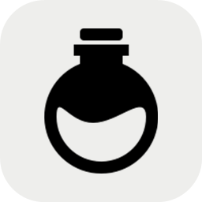
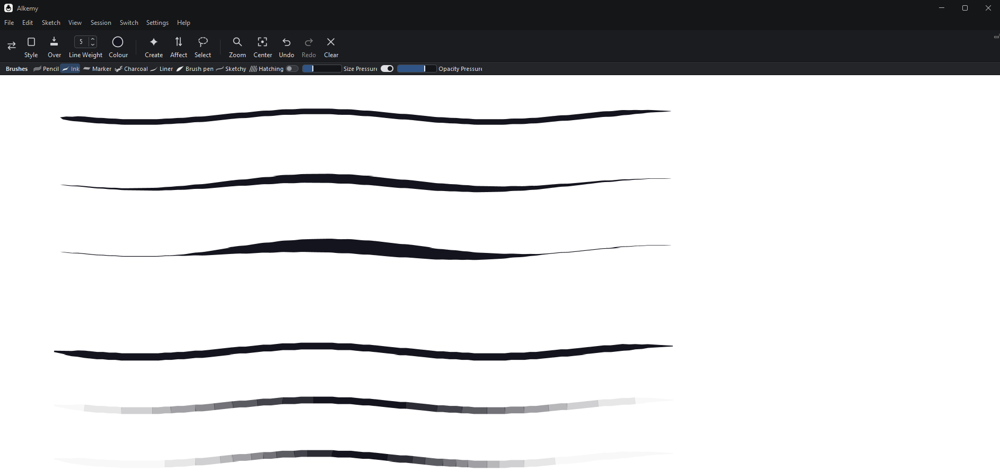
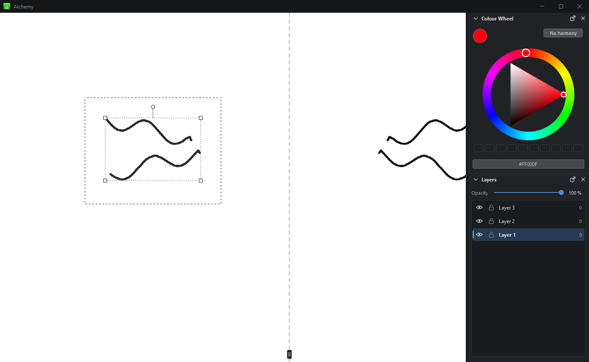
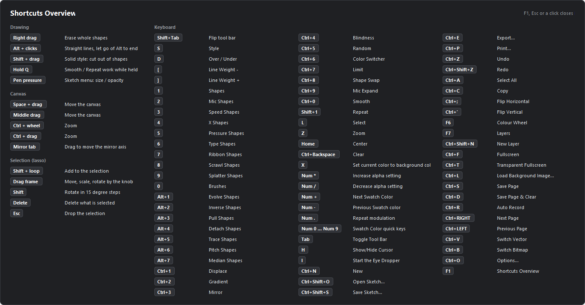
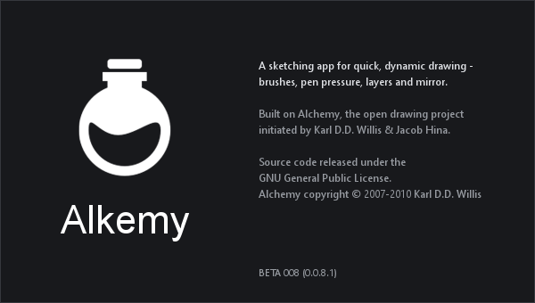
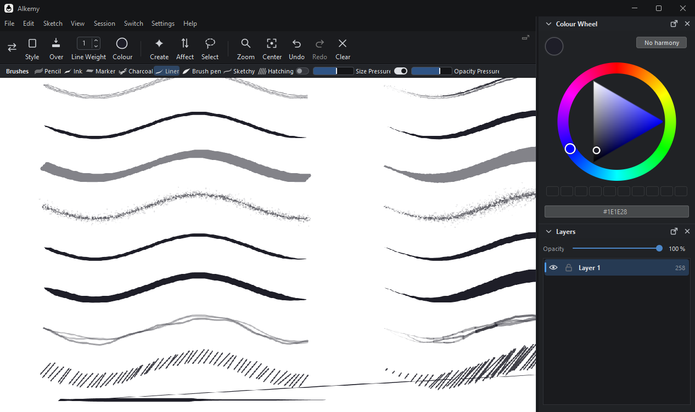

<p align="center">
  
</p>

<h1 align="center">Alkemy</h1>

<p align="center">
  A sketching app for quick, dynamic drawing - brushes, pen pressure, layers and mirror.<br>
  Built on <a href="http://al.chemy.org">Alchemy</a>, the open drawing project by Karl D.D. Willis &amp; Jacob Hina.
</p>

## Why Alkemy

Lie on your back and watch the clouds. Nobody painted them, yet after a moment one turns into a whale,
another into a face, a castle, a running dog. The picture was never in the cloud - it appeared because
you were looking for it.

Alkemy is a sketching app built around that moment. Instead of asking you to draw exactly what you
already have in your head, it lets you throw down quick, loose, slightly unpredictable marks - mirrored,
displaced by noise, repeated, shaped by the pressure and speed of your hand - and then look into them,
the way you look into clouds, and find the dragon, the robot or the character hiding there.
It is a tool for the very first stage of an idea, before you know what it will become.



## Download

Get the latest **`Alkemy-x.y.z-windows-x64.zip`** from [Releases](../../releases), unzip it anywhere and run **`Alkemy.exe`**.
Java comes inside - there is nothing else to install.

## What is new compared to Alchemy

**Drawing**
- **Brushes** for fast, dynamic sketching - pencil, ink, marker, charcoal, liner, brush pen, sketchy lines and hatching
- **Pen pressure** (Wacom / Wintab and Windows Ink) changing the **size**, the **opacity** or both, with strength sliders and on / off switches
- **Stabilizer**, **straight polygon lines** (Alt + clicks) and **Solid cut** (Shift + drag cuts shapes away)
- **Mirror** with draggable axes; Smooth and Repeat follow the mirror and work only while **Q** is held
- **Displace** with several noise types (Perlin, turbulence, ridged, cellular, glitch...) and your own image as noise

**Canvas and tools**
- **Undo / redo**, **layers** (opacity, lock, hide, reorder), **lasso selection** (move, scale, rotate, delete)
- Endless canvas with **zoom and pan** that stays smooth on heavy drawings
- **Export** of a chosen area as PNG (also with a transparent background), JPG, PDF or SVG; editable **.alchemy sketch** files
- Dark modern look, colour wheel and layers in a **dock** on the right, a **file browser** with image preview
- **F1** shows every shortcut

| | |
|---|---|
|  |  |
|  |  |

## Building from source

Needs only a **JDK 22 or newer** (Windows).

```powershell
powershell -ExecutionPolicy Bypass -File build.ps1            # build into dist\Alchemy - start it with Alkemy.bat
powershell -ExecutionPolicy Bypass -File build.ps1 -Run       # build and start
powershell -ExecutionPolicy Bypass -File build.ps1 -Package   # also make release\Alkemy-<version>-windows-x64.zip
```

### Tests

The tests run inside the app with simulated mouse and pen input and check drawing, undo, layers, the lasso, mirror,
pen pressure, export and more. Screenshots are written to `tests\shots`.

```powershell
powershell -ExecutionPolicy Bypass -File test.ps1             # all tests
powershell -ExecutionPolicy Bypass -File test.ps1 LayerTest   # just some
```

### Project layout

| Folder | What is in it |
|---|---|
| `src/org/alchemy/core` | The app - window, canvas, tool bar, dock, pen input, undo, layers, export |
| `src/org/alchemy/create`, `src/org/alchemy/affect` | The drawing tools (Create) and the effects (Affect), loaded as plugins |
| `modules` | Plugin descriptions of the tools and effects |
| `lib` | Libraries (FlatLaf, JPen, JPF, iText, Batik, PDFRenderer...) |
| `shapes` | Shape libraries used by Pull Shapes |
| `tests` | Regression tests |

## Licence

Alkemy is free software under the **GNU General Public License v3** - see [LICENSE.md](LICENSE.md).
You may use, change, share and also sell it, as long as the source code stays available under the same licence.

Alkemy is based on Alchemy, copyright © 2007-2010 Karl D.D. Willis, initiated by Karl D.D. Willis & Jacob Hina.
The libraries in `lib` keep their own licences.
